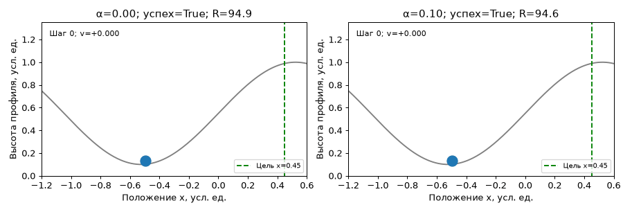

# HW4: устойчивость SAC к шуму наблюдений

Итоговый проект по дисциплине «Обучение с подкреплением», трек 1: агент в классической среде `MountainCarContinuous-v0`.

Основной файл: [Teplyakov_AN_HW4.ipynb](Teplyakov_AN_HW4.ipynb).

## Исследовательский вопрос, гипотеза и обоснование

**Исследовательский вопрос:** как увеличение гауссовского шума в наблюдениях влияет на качество агента SAC, обученного без шума в `MountainCarContinuous-v0`?

**Гипотеза:** при шуме `α = 0.10` средняя по seed обучения доля успешных эпизодов снизится минимум на 20 процентных пунктов относительно `α = 0`. Дополнительные метрики — суммарная награда, длительность эпизода и затраты управления `Σa²`.

**Обоснование постановки:** положение и скорость определяют момент смены тяги при раскачивании, поэтому ошибки наблюдения могут ухудшать управление. Среда с двумя наблюдаемыми величинами позволяет задавать шум относительно диапазона каждого признака. Непрерывное действие соответствует области применения SAC; буфер повторов и энтропийная регуляризация поддерживают обучение и исследование. Шум добавляется только при оценке, чтобы исследовать устойчивость уже обученной политики. Неизменные гиперпараметры и парные начальные состояния позволяют сравнивать уровни шума при одинаковых остальных условиях; три seed показывают вариативность обучения.

Агент SAC (Soft Actor-Critic) обучается без шума. При оценке параметры политики заморожены, действия выбираются детерминированно. Основное сравнение — шум `α = 0.10` против отсутствия шума; проверяемый размер эффекта — снижение доли успехов минимум на 20 процентных пунктов.

## Среда и шум

В `MountainCarContinuous-v0` машина набирает скорость раскачиванием, чтобы подняться на правый склон.

| Параметр | Значение |
| --- | --- |
| Наблюдение | Положение `x ∈ [−1.2, 0.6]`, скорость `v ∈ [−0.07, 0.07]` |
| Действие | Непрерывная тяга `a ∈ [−1, 1]` |
| Цель | Достижение `x ≥ 0.45` при выполнении условия среды по скорости |
| Награда | `100` при достижении цели, штраф `0.1a²` на каждом шаге |
| Лимит эпизода | 999 шагов |

Успех определяется по `terminated`; завершение только по лимиту времени (`truncated`) успехом не считается.

Обёртка `NoisyObservationWrapper` изменяет только наблюдения агента:

```text
observed_state = clip(state + α · observation_range · z, low, high)
z ~ N(0, I), observation_range = [1.8, 0.14]
```

Таким образом, `α` задаёт стандартное отклонение шума до обрезки как долю диапазона каждого признака. Физика среды и функция награды сохраняются.

## Постановка эксперимента

- Seed обучения: `42`, `123`, `777`.
- Бюджет: 50 000 шагов на seed; фактически 50 016 из-за завершения пакета взаимодействий.
- Уровни шума при оценке: `0`, `0.01`, `0.05`, `0.10`.
- По 20 тестовых эпизодов на каждую комбинацию seed обучения и уровня шума: всего 240 эпизодов.
- Seed оценки: `10 000–10 019`, отдельно от seed обучения.
- Между уровнями шума совпадают seed начальных состояний и базовые случайные последовательности шума.
- Обучение выполняется на CPU с одним потоком PyTorch; лимит времени — 30 минут на seed.

Тестовые эпизоды не используются для обновления политики или выбора контрольной точки.

### Параметры SAC

| Параметр | Значение |
| --- | --- |
| Политика | `MlpPolicy`, два скрытых слоя по 64 нейрона |
| `learning_rate` | `3e-4` |
| `buffer_size` | `50_000` |
| `learning_starts` | `0` |
| `batch_size` | `512` |
| `gamma` | `0.9999` |
| `tau` | `0.01` |
| `train_freq` / `gradient_steps` | `32` / `32` |
| `ent_coef` | `0.1` |
| Исследование | gSDE: `use_sde=True`, `log_std_init=-3.67` |

## Запуск

В сохранённом запуске использовался Python 3.12.3. Версии основных библиотек указаны в установочной ячейке ноутбука; полный список окружения сохранён в [HW4_artifacts/pip-freeze.txt](HW4_artifacts/pip-freeze.txt).

Откройте терминал в папке `HW4_report` (там, где находится этот README), создайте отдельное окружение и установите зависимости:

```bash
python3 -m venv .venv-hw4
source .venv-hw4/bin/activate
python -m pip install -r requirements.txt
python -m ipykernel install --user --name hw4 --display-name "Python (HW4)"
jupyter lab Teplyakov_AN_HW4.ipynb
```

Выберите ядро `Python (HW4)` и выполните все ячейки последовательно. Команды фиксируют версии из ноутбука; доступность установки этих версий при подготовке README не проверялась. Локальный [requirements.txt](requirements.txt) содержит основные зависимости именно HW4 и средства запуска с версиями из сохранённого окружения. Полный `pip freeze` также включает пакеты других заданий и CUDA; для обычного запуска достаточно локального `requirements.txt`.

По умолчанию `FORCE_RETRAIN = False`: результаты обучения используются повторно, если присутствуют модель, журнал и метаданные с совпадающей конфигурацией, включая версии основных библиотек. При несовпадении обучение запускается заново. Для принудительного переобучения установите `FORCE_RETRAIN = True` в первой ячейке настройки. Оценка и построение графиков выполняются заново при запуске соответствующих ячеек.

Все результаты записываются в `HW4_artifacts/` относительно текущей рабочей директории. Повторное выполнение перезаписывает соответствующие артефакты, включая `pip-freeze.txt`. Для анимации используются Matplotlib и Pillow; `pygame` не требуется.

## Код и воспроизводимость

[Ноутбук](Teplyakov_AN_HW4.ipynb) содержит полный код настройки окружения, обёртки шума, обучения трёх агентов, оценки, проверок результатов, построения графиков и GIF. Сохранены исходные ячейки и их результаты. Для просмотра отчёта повторный запуск не требуется.

В ноутбуке предусмотрены проверки нулевого шума и его повторяемости, границ действий, числа и длины тестовых эпизодов, а также тождества `reward = 100 × success − 0.1 × Σa²`. Версии основных библиотек сохранены как в выводе ноутбука, так и в метаданных каждого обучения. Обучение в сохранённом запуске занимало примерно 4.6–5.0 минут на seed; на другом оборудовании время может отличаться.

## Результаты сохранённого запуска

Значения представлены как **среднее ± выборочное стандартное отклонение средних по трём seed обучения**. Каждый агент оценён на 20 эпизодах для каждого уровня шума. Это стандартное отклонение, а не доверительный интервал.

| Уровень шума α | Успех, % | Награда | Длина, шаги | Затраты управления Σa² |
| --- | --- | --- | --- | --- |
| 0.00 | 100.00 ± 0.00 | 94.58 ± 0.10 | 88.80 ± 6.56 | 54.21 ± 1.02 |
| 0.01 | 100.00 ± 0.00 | 94.48 ± 0.20 | 90.28 ± 6.74 | 55.23 ± 2.01 |
| 0.05 | 100.00 ± 0.00 | 93.89 ± 0.43 | 99.12 ± 2.01 | 61.10 ± 4.31 |
| 0.10 | 100.00 ± 0.00 | 92.12 ± 0.64 | 129.57 ± 18.70 | 78.85 ± 6.36 |

Все 240 эпизодов завершились достижением цели. Гипотеза о снижении доли успехов минимум на 20 п. п. при `α = 0.10` в этом эксперименте не подтвердилась. При этом относительно отсутствия шума:

- средняя награда снизилась примерно на **2.46**;
- средняя длина эпизода выросла на **45.9%**;
- затраты управления выросли на **45.4%**.

На выбранной сетке агент сохраняет способность достигать цели, но становится менее эффективным по времени и затратам управления. Это вывод по полученной выборке: три seed и конечное число эпизодов не гарантируют отсутствие редких неудач. Проверены одна среда, одна конфигурация SAC и только независимый гауссовский шум с обрезкой. Для дальнейшей проверки предлагается увеличить число seed и исследовать шум выше 10% на новой тестовой выборке.

### Объяснение наблюдений

С ростом шума наблюдаемые положение и скорость становятся менее точными. Более длинные эпизоды и рост суммы квадратов действий согласуются с дополнительными корректировками тяги и раскачиванием. При неизменном успехе снижение награды полностью согласуется со штрафом за затраты управления: `Δreward = −0.1 × ΔΣa²`. Рост этой суммы зависит и от длительности эпизода, поэтому сам по себе не доказывает увеличение тяги на каждом шаге.

Возможное объяснение сохранения успеха — корректирующая обратная связь и запас времени до лимита 999 шагов: даже при `α = 0.10` средняя длительность составляет около 130 шагов. Это интерпретация, а не отдельно проверенный причинный механизм. Нулевой разброс успехов отражает потолок метрики на данной выборке, а не отсутствие неопределённости.

Следует отдельно проверить больше seed, более сильный шум, постоянное смещение и задержки датчиков. Сравнение обучения с шумом и без шума потребует нового эксперимента с одинаковыми бюджетами и отдельными тестовыми данными.

## Графики и визуализация

На кривых обучения точки соответствуют завершённым обучающим эпизодам, а каждая линия — скользящему среднему максимум по 10 последним эпизодам одного seed. Усреднения между seed на этом графике нет; разброс отдельных эпизодов виден по точкам. Эти кривые описывают обучение, а итоговые выводы сделаны по отдельным тестовым эпизодам.

На графике сравнения условий тонкие линии показывают средние каждого агента, чёрная линия — среднее по трём seed, столбики ошибок — выборочное SD этих трёх средних. Графики содержат заголовки, подписи осей, единицы измерения и легенды.

## Артефакты

| Файл в `HW4_artifacts/` | Содержимое |
| --- | --- |
| `sac_seed_{seed}.zip` | Итоговые модели SAC для трёх seed |
| `train_{seed}.monitor.csv` | Награды и длины завершённых обучающих эпизодов |
| `train_{seed}.json` | Конфигурация, версии, время и фактическое число шагов обучения |
| `training_times.csv` | Сводка времени обучения |
| `evaluation_episodes.csv` | Исходные результаты всех 240 тестовых эпизодов |
| `evaluation_per_seed.csv` | Средние метрики по seed обучения и уровню шума |
| `evaluation_summary.csv` | Итоговые средние и стандартные отклонения по seed |
| `paired_success_delta_pp.csv` | Парное изменение доли успехов относительно чистых наблюдений |
| `learning_curves.png` | Кривые обучения со скользящим средним до 10 эпизодов |
| `noise_comparison.png` | Сравнение четырёх метрик при разных уровнях шума |
| `sac_behavior.gif` | Поведение агента при `α = 0` и `α = 0.10` |
| `conclusion.md` | Вывод, сформированный по тестовым данным |
| `pip-freeze.txt` | Полный список пакетов окружения |

Анимация использует заранее выбранные seed обучения `42` и оценки `10 000`; выводы основаны на полной тестовой выборке.




## Состав папки для сдачи

```text
HW4_report/
├── README.md
├── Teplyakov_AN_HW4.ipynb
├── requirements.txt
└── HW4_artifacts/       # Все сохранённые модели, журналы, таблицы, графики, GIF и pip freeze
```

Для размещения в GitHub загрузите содержимое этой папки целиком, сохранив относительные пути. README объединяет исследовательский вопрос, гипотезу, методику, результаты и анализ; ноутбук содержит полный код, а `HW4_artifacts/` — данные для проверки выводов. В папку также включены исходные `execution.log` и `train_777.log` как дополнительные журналы запуска.
