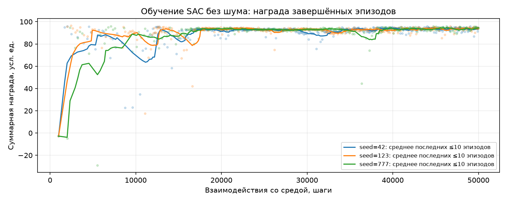
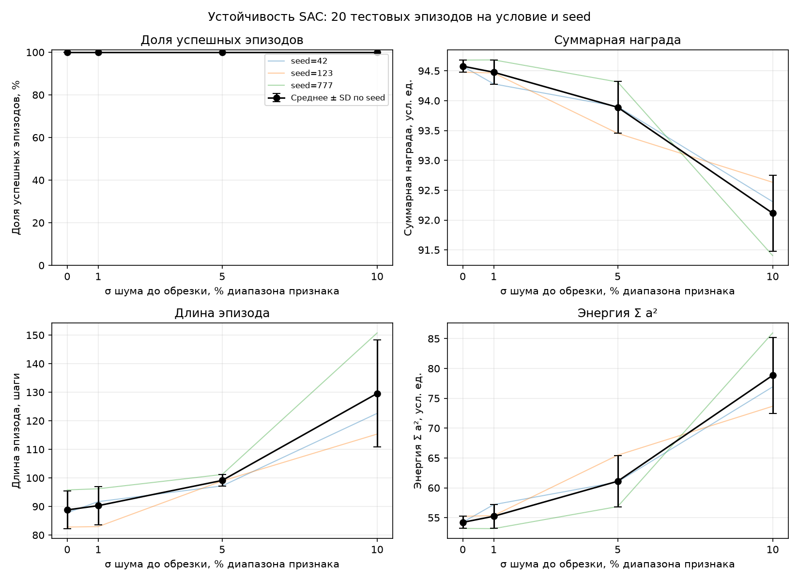

# HW4: устойчивость SAC к шуму наблюдений

## Итоговый проект по дисциплине «Обучение с подкреплением»
### Трек 1: агент в классической среде `MountainCarContinuous-v0`

## Исследовательский вопрос
`MountainCarContinuous-v0` является классической средой из библиотеки Gymnasium. Она используется для обучения с подкреплением (Reinforcement Learning). В ней агент управляет маломощным автомобилем, которому нужно раскачаться между двумя холмами, чтобы заехать на вершину правого склона.

Как увеличение гауссовского шума в наблюдениях может влиять на качество агента SAC (Soft Actor-Critic), обученного без шума в `MountainCarContinuous-v0`?

### Гипотеза
Если значение шума будет `α = 0.10`, то среднаяя по seed доля успешных эпизодов снизится более чем на 20 процентных пунктов относитьльно значения `α = 0`. В качестве дополнительной метрики будет использованра сумарная награда, длитальеность эпизода и затраты управления (`Σa²`).

### Обоснование постановки
Положение и скорость определяют момент смены тяги при раскачивании машинки.Следовательно,ошибки наблюдения могут оказываит влияние на управление. Среда с двумя наблюдаемыми величинами позволяет задавать шум относительно диапазона каждого признака. Мы моежми добавлять шум добавляется при оценке, чтобы исследовования устойчивости политики, которую мы обучили без шума. Неизменные гиперпараметры и парные начальные состояния позволяют сравнивать уровни шума при одинаковых остальных условиях; три seed показывают вариативность обучения.

Агента SAC (Soft Actor-Critic) мы будем оубчать без шума. При оценке параметры политики и веса будут заморожены. Основное сравнение — шум `α = 0.10` против отсутствия шума; проверяемый размер эффекта — снижение доли успехов минимум на 20 процентных пунктов.

## Среда и шум

В `MountainCarContinuous-v0` машина набирает скорость раскачиванием, чтобы подняться на правый склон.

| Параметр | Значение |
| --- | --- |
| Наблюдение | Положение `x ∈ [−1.2, 0.6]`, скорость `v ∈ [−0.07, 0.07]` |
| Действие | Непрерывная тяга `a ∈ [−1, 1]` |
| Цель | Достижение `x ≥ 0.45` при выполнении условия среды по скорости |
| Награда | `100` при достижении цели, штраф `0.1a²` на каждом шаге |
| Лимит эпизода | 999 шагов |

Успех будет нами определяться строго по `terminated`, завершения по лимиту времени (`truncated`) успехом не считаются.

Обёртка `NoisyObservationWrapper` влияет только наблюдения нашего агента:

```text
observed_state = clip(state + α · observation_range · z, low, high)
z ~ N(0, I), observation_range = [1.8, 0.14]
```

Таким образом, `α` будет задавть стандартное отклонение шума. Физика среды и функция награды остаются без измениний.

## Постановка эксперимента

- Три значения Seed обучения: `42`, `123`, `777`.
- Бюджет: 50 000 шагов на seed; фактически 50 016 из-за завершения пакета взаимодействий.
- Четыре уровня шума при оценке: `0`, `0.01`, `0.05`, `0.10`.
- По 20 тестовых эпизодов на каждую комбинацию seed обучения и уровня шума: всего 240 эпизодов.
- Seed оценки: `10 000–10 019`, он задается отдельно от SEED обучения.
- Между уровнями шума совпадают seed начальных состояний и базовые случайные последовательности шума.
- Обучение выполняется на CPU с одним потоком PyTorch, лимит времени установлен 30 минут на seed.

Тестовые эпизоды не используются для обновления политики или выбора контрольной точки.

### Параметры SAC

| Параметр | Значение |
| --- | --- |
| Политика | `MlpPolicy`, два скрытых слоя по 64 нейрона |
| `learning_rate` | `3e-4` |
| `buffer_size` | `50_000` |
| `learning_starts` | `0` |
| `batch_size` | `512` |
| `gamma` | `0.9999` |
| `tau` | `0.01` |
| `train_freq` / `gradient_steps` | `32` / `32` |
| `ent_coef` | `0.1` |
| Исследование | gSDE: `use_sde=True`, `log_std_init=-3.67` |

## Запуск

В сохранённом запуске использовался Python 3.12.3. Версии основных библиотек указаны в установочной ячейке ноутбука; полный список окружения сохранён в [HW4_artifacts/pip-freeze.txt](HW4_artifacts/pip-freeze.txt).

Откройте терминал в папке `HW4_report` (там, где находится этот README), создайте отдельное окружение и установите зависимости:

```bash
python3 -m venv .venv-hw4
source .venv-hw4/bin/activate
python -m pip install -r requirements.txt
python -m ipykernel install --user --name hw4 --display-name "Python (HW4)"
jupyter lab Teplyakov_AN_HW4.ipynb
```
Все результаты записываются в `HW4_artifacts/` относительно текущей рабочей директории. Повторное выполнение перезаписывает соответствующие артефакты, включая `pip-freeze.txt`. Для анимации используются Matplotlib и Pillow; `pygame` не требуется.

## Результаты сохранённого запуска

Значения представлены как **среднее ± выборочное стандартное отклонение средних по трём seed обучения**. Каждый агент оценён на 20 эпизодах для каждого уровня шума. Это стандартное отклонение, а не доверительный интервал.

| Уровень шума α | Успех, % | Награда | Длина, шаги | Затраты управления Σa² |
| --- | --- | --- | --- | --- |
| 0.00 | 100.00 ± 0.00 | 94.58 ± 0.10 | 88.80 ± 6.56 | 54.21 ± 1.02 |
| 0.01 | 100.00 ± 0.00 | 94.48 ± 0.20 | 90.28 ± 6.74 | 55.23 ± 2.01 |
| 0.05 | 100.00 ± 0.00 | 93.89 ± 0.43 | 99.12 ± 2.01 | 61.10 ± 4.31 |
| 0.10 | 100.00 ± 0.00 | 92.12 ± 0.64 | 129.57 ± 18.70 | 78.85 ± 6.36 |

Все эпизоды завершились успехом, а гипотеза о снижении доли успехов минимум на 20 п. п. при `α = 0.10` не подтвердилась. При этом относительно отсутствия шума:

1. Средняя награда снизилась примерно на **2.46**.
2. Средняя длина эпизода выросла на **45.9%**.
3. Затраты управления выросли на **45.4%**.

Агент сохранил способность достигать цели, но становится чуть менее эффективным по времени и затратам управления.  Для дальнейшей проверки предлагается увеличить число seed и исследовать шум выше 10% на новой тестовой выборке.

### Объяснение наблюдений

С ростом шума наблюдаемые положение и скорость становятся менее точными. Агент тратит больше шагов на обучения. Следовательно получает больший штраф.Награда падает.

Возможное объяснение сохранения успеха в том, что у агента есть запас времени до лимита 999 шагов. При `α = 0.10` средняя длительность сессии составляет 130 шагов. Это интерпретация, а не отдельно проверенный причинный механизм. Нулевой разброс успехов отражает потолок метрики на данной выборке, а не отсутствие неопределённости.
При дальнейших наблюдениях следует проверить больше seed, сделать зашумиление более сильным или создать постоянное смещение и задержки датчиков.

## Графики и визуализация

На кривых обучения точки соответствуют завершённым обучающим эпизодам, а каждая линия — скользящему среднему максимум по 10 последним эпизодам одного seed.

На графике сравнения условий тонкие линии показывают средние каждого агента, чёрная линия — среднее по трём seed, столбики ошибок — выборочное SD этих трёх средних. Графики содержат заголовки, подписи осей, единицы измерения и легенды.

## Артефакты

| Файл в `HW4_artifacts/` | Содержимое |
| --- | --- |
| `sac_seed_{seed}.zip` | Итоговые модели SAC для трёх seed |
| `train_{seed}.monitor.csv` | Награды и длины завершённых обучающих эпизодов |
| `train_{seed}.json` | Конфигурация, версии, время и фактическое число шагов обучения |
| `training_times.csv` | Сводка времени обучения |
| `evaluation_episodes.csv` | Исходные результаты всех 240 тестовых эпизодов |
| `evaluation_per_seed.csv` | Средние метрики по seed обучения и уровню шума |
| `evaluation_summary.csv` | Итоговые средние и стандартные отклонения по seed |
| `paired_success_delta_pp.csv` | Парное изменение доли успехов относительно чистых наблюдений |
| `learning_curves.png` | Кривые обучения со скользящим средним до 10 эпизодов |
| `noise_comparison.png` | Сравнение четырёх метрик при разных уровнях шума |
| `sac_behavior.gif` | Поведение агента при `α = 0` и `α = 0.10` |
| `conclusion.md` | Вывод, сформированный по тестовым данным |
| `pip-freeze.txt` | Полный список пакетов окружения |

Анимация использует заранее выбранные seed обучения `42` и оценки `10 000`; выводы основаны на полной тестовой выборке.






